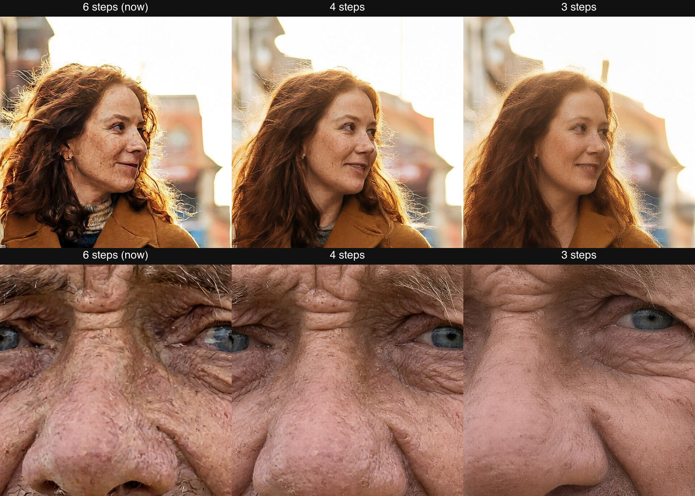
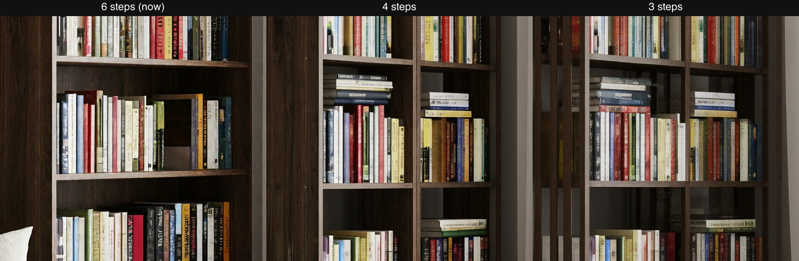
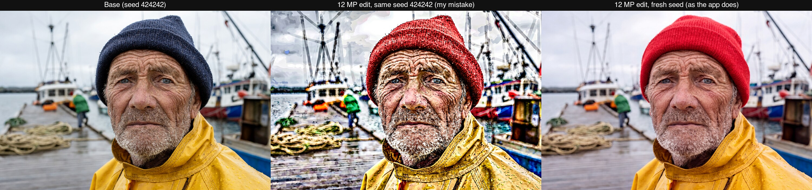
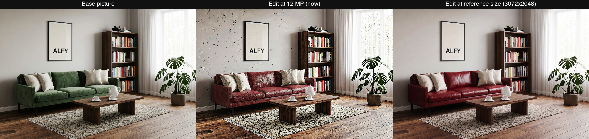
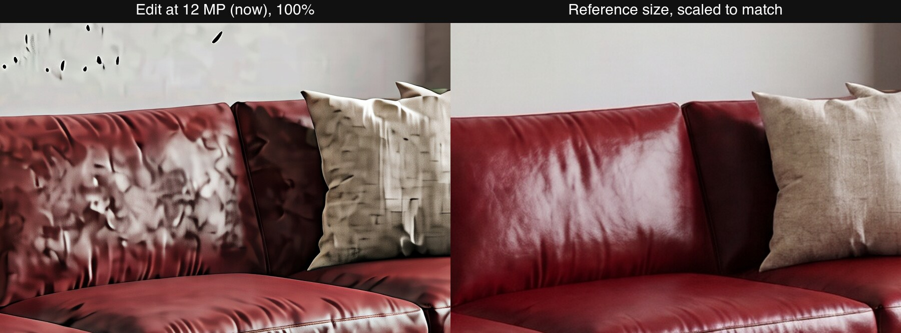
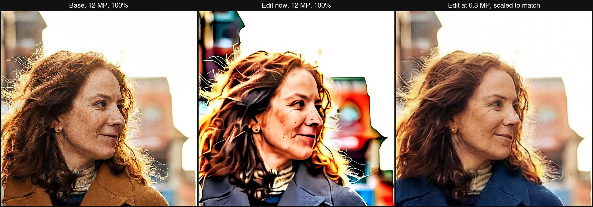
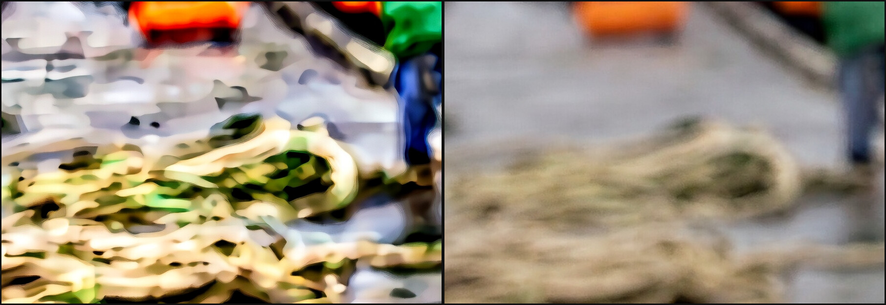
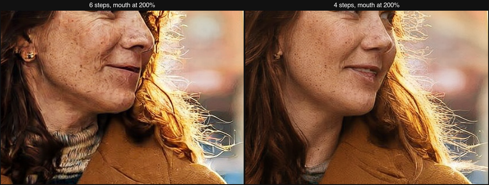

# H3 picture speed on alfyroot: where the time goes and what would cut it

Date: 2026-11-18. Scope: the live `comfyui-h3` server (ComfyUI 0.44.0 at `ede4e5fe8d`, comfy-kitchen 0.2.41, comfy-aimdo 0.6.0, torch 2.14.1+cu130) on GPU1, the RTX PRO 5000 Blackwell (48 GB, PCIe 5.0 at x8). Method: its journal since the 12 MP switch (48 production pictures), 13 synthetic test renders the owner approved (12 rendered, one was a ComfyUI cache hit; 12 MP, seed 424242, three prompts, the production graphs), `nvidia-smi dmon` during the renders, and 100% crops. No prompt text of anyone's was read; the journal holds timings only. Nothing on the box was changed.

## TL;DR

- **There is no free 2x in the sampler.** At 12 MP both the matrix maths (int8 W8A8 with convrot) and the attention (comfy-kitchen int8, which the checkpoint asks for on every block) already run in int8, at roughly two-thirds of the card's int8 peak. Kernel or attention swaps can buy little; the only 2x precision step is FP4, and the earlier NVFP4 test was rejected for waxy skin.
- **Three real wins, measured:**
  1. **New pictures at 4 steps instead of 6:** 15.8 s → 11.6 s on the server (−27%). At 100% the three test prompts look nearly the same; the owner compared them full size in a side-by-side viewer and judged 4 steps better: "a little less detailed but much more stable and less noisy". **3 steps** saves 39% but the skin goes visibly waxy and shelves ghost: not recommended. MiniMax documents 6 steps only, so this is an owner's call on our own pictures, not a supported setting.
  2. **Edits could be 34-51% faster at a 2048 px short edge** (about 6.3 MP for 3:2; sampling 24 s → 16 s), at the cost of a ~6 MP result instead of 12 MP. That is a size-for-speed trade only. The "broken 12 MP edits" this doc first reported were a mistake in my test, not the app: the harness edited each picture with the very seed that made it, which the app never does (see the edit section).
  3. **CPU-side stalls, cause found:** in about half of production pictures the GPU sits idle for 4-27 s, before the reference encode or after the decode. That is 2.7 s per new picture and 4.4 s per edit on average, up to 27 s. It is the kernel compacting memory for transparent huge pages that NumPy asks for on every large array; ComfyUI builds such arrays around every 12 MP picture. `NUMPY_MADVISE_HUGEPAGE=0` in the ComfyUI units removes it (measured in isolation on the box: 7.5 s → 0.05 s). Not applied yet; see the stall section.
- **Combined estimate:** a new picture ~20 s → ~12 s; an edit ~35 s → ~16-20 s. Every number except these two estimates is measured.

## Where the time goes now (production, 12 MP)

From the H3 server's journal since 2026-11-12 20:00 UTC (the LTX trial runs on the same server are left out):

| | n | Median | Text encoder | Sampling | Decode + save | Stalls > 3 s |
|---|---:|---:|---:|---:|---:|---:|
| New picture | 21 | 19.6 s | 1.2-2.5 s (3.4 s cold) | 11.3-14.3 s | 1.3-1.7 s | 52% of runs, 2.7 s avg |
| Edit | 27 | 35.1 s | 3.3-4.8 s | 20.5-27.2 s | 1.3-1.8 s | 56% of runs, 4.4 s avg |

Sampling's progress bars: a new picture's first step takes 3.0-4.2 s (it pages the 20 GB DiT back in after the text encoder) and every later step 1.87-1.94 s; an edit's first step 5.0-5.9 s and later steps ~4.2 s. An edit costs about 2.2x a new picture per step because the reference adds ~6,100 image tokens (at a 2048 px short edge) and Qwen's ~2,000 vision tokens to the ~11,600 target tokens, and attention grows with the square.

The weight shuffle: GPU1 has about 26 GB free beside MinerU, the two TEI models and three ComfyUI contexts, so the 15 GB text encoder and the 20 GB DiT cannot both stay resident. Every job pages the encoder in, then the DiT back in. For a new picture, warm (jobs back to back), that is ~1.4 s of encoder phase plus ~0.75 s of extra first step; production jobs, spread out over the day, pay 1.2-2.5 s plus 1.1-2.3 s.

## The hardware ceiling

A 12 MP new picture packs ~11,900 tokens (264x176 latent, 2x2 patches, plus the prompt). Per step that is ~4.6e14 operations in the 50 blocks' linear layers and ~2.0e14 in attention, ~6.6e14 in all, every one of them int8. At 1.87-2.0 s per step the card delivers ~330-350 TOPS, about 65-68% of its dense int8 peak (~520 TOPS, estimated as a quarter of the datasheet's 2,064 sparse FP4 TOPS). Even a perfect 90% would only be ~1.35x faster, and no available kernel is near that. So the big levers are fewer steps, fewer tokens, or FP4.

## Measured options (today's runs, warm, 12 MP unless marked)

| Run | Total | Text enc. | Sampling | Decode + save | Note |
|---|---:|---:|---:|---:|---|
| New picture, 6 steps (now) | 15.7-16.0 s | 1.4-1.6 s | 12.5-12.8 s | 1.5-1.7 s | 2.0 s/step |
| New picture, 4 steps | 11.6-11.7 s | 1.4 s | 8.7 s | 1.4-1.5 s | −27% |
| New picture, 3 steps | 9.7 s | 1.4 s | 6.8 s | 1.4 s | −39% |
| Edit, 6 steps (now) | 30.8 s | 3.7 s | 24.1 s | 1.6 s | 3.9 s/step |
| Edit, 3 steps | 13.2 s | cached | 11.5 s | 1.7 s | a fresh one is ~18 s |
| Edit at reference size, 6 steps | 46.5 s | 3.6 s | 15.6 s | 0.7 s | 26.6 s stall before the encode; ~20 s without it |

Two of the twelve renders had an 8.4 s and a 10.3 s decode-and-save phase (the 3-step street picture is one of them, hence its 18.6 s in the raw table); `speed-bench/phases-run-a.txt` has every row.

### Steps: 4 holds, 3 does not

The model's PDD head bank is distilled on a 6-interval sigma grid; ComfyUI's H3 code averages the heads a coarser step spans, so 3 steps (each spanning two intervals) lands exactly on grid points and 4 steps lands between them. At 100%:

- **4 steps:** the fisherman's pores and wrinkles are as deep as at 6 steps and his eyes cleaner (the 6-step render has a milky highlight in one eye); the street portrait keeps freckles and hair strands, the skin a little smoother; the bookshelf is as clean.
- **3 steps:** the skin goes smooth and low-contrast, the waxy direction the 4 MP trial was rejected for; hair softens; the bookshelf shows doubled, ghosted uprights.

Compositions shift a little between step counts for the same seed, so a switch changes the picture a seed gives, not only its detail.

### Edits: the 12 MP canvas against the reference size

> **Correction (2026-11-18, same day).** The artefacts below were caused by the test, not by the app. Every broken edit reused the seed that made its base (424242) on the same 4224x2816 canvas, so the edit began from exactly the noise that drew the base. The app has refused that since 2026-10-27 (`avoidSeeds`, "never reuse an input's seed"; `enqueueTake` redraws such a seed). The clean cases differed in the noise, not in the canvas: a reference-size canvas has another shape, and the 4 MP and 1 MP bases were made with other seeds and sizes. The owner's week of edits looking right is the production evidence. **Verified:** the two worst cases (fisherman, street), edited again at the app's 12 MP canvas with fresh seeds (771001, 771002), are clean: natural background blur, the same face and freckles (`samples/speed-edit-seed-check-fisherman.jpg`, `samples/speed-edit-seed-check-face.jpg`). The harness now refuses an edit with its base's seed. What stands from this section: the timings, and the H3 same-seed trap itself, which shows why `avoidSeeds` matters for H3 too.

`MiniMaxH3ImageConditioning` VAE-encodes every reference with its short edge clamped to 1024-2048 px (`IMAGE_REF_VAE_MAX_SHORT_EDGE`) and shows Qwen a 1024 px copy. The app's `canvasForEdit` asks for 12 MP regardless, so a 4224x2816 base is edited on a 4224x2816 canvas from a 3072x2048 reference: the model works at 1.375x the scale of the picture it is given. With width and height at 0, the node's default, it renders at the reference's own size instead.

On the test (green velvet sofa to red leather): the 12 MP edit kept the room's layout but re-textured everything, with black splotches on the plain wall, a harsh black-and-white rug, over-sharpened floorboards, smeared leather and blocky cushions, at 6 steps and at 3. The reference-size edit is clean and faithful to the base, and its sampling takes 2.4 s per step against 3.9 s.

**Five more edits (2026-11-18, seed 424242, 6 steps), each at the app's 12 MP canvas and at a 2048 px short edge.** The app's own input path was reproduced: a 12 MP base goes up as it is and the node Lanczos-shrinks it to a 2048 px short edge.

| Base | Edit | 12 MP canvas (now) | 2048 px short edge |
|---|---|---|---|
| H3 12 MP street portrait | coat to navy | over-sharpened and oversaturated; at 100% the face is a comic-book drawing (black outlines, posterised skin, halos) | clean, same woman, freckles kept |
| H3 12 MP fisherman | cap to red | soft background posterised into oil-paint blobs, skin crunchy | clean, natural blur |
| H3 12 MP room | add a cat | wall splotches, harsh rug, mottled velvet, layout kept | clean, but reframed to a sofa close-up |
| Qwen 4 MP square | evening light | clean | clean |
| 1 MP square (app-side upscale for the right column) | glass table | clean | clean |

With the first sofa test that is 4 of 4 broken, and all four are the cases where the edit's seed and canvas equalled its base's (424242 at 4224x2816). The 0 of 2 clean 12 MP cases had bases made with other seeds and sizes, and every reference-size edit had a different noise shape. That is the same-seed trap (see the correction above), not a property of 12 MP edits.

What was ruled out on the way, still true: the 12 MP edit runs fully resident (GPU1 at 48.2 of 48.9 GB, 100% SM, 0-157 MB/s of PCIe during sampling), so no weights are shuffled mid-render, and the official ComfyUI edit template also renders larger than its reference (a 3104x3104 canvas from ~4 MP references).

Timings, sampling only (the stalls below come on top): a 3:2 edit 23.9-24.1 s at 12 MP against 15.8-16.0 s at 3072x2048; a square one 20.4 s at 3456x3456 against 9.8-10.0 s at 2048x2048.

Full frames: `samples/speed-edit-e1.jpg` … `speed-edit-e5.jpg`.

### CPU-side stalls

What is measured: in the two slow decodes the GPU ran the decode at 100% for 1-2 s, then sat at 0% SM and ~75 W with no PCIe traffic for 6-9 s before ComfyUI reported the prompt done. The reference-size edit waited 25.8 s, with nothing logged, between `got prompt` and the VAE encode, which is CPU work on a 12 MP picture (load, two Lanczos resizes). Production shows the same pattern in about half of all jobs.

Ruled out: spinning disks (models, input and temp are all on the NVMe), streaming the VAE over PCIe (no traffic), host CPU load (98-99% idle), the app's idle free (15 min; the gap was 4 min, and no model reloaded), other services (only vLLM, the mail server and Element logged in the 26 s window).

**Cause (found 2026-11-18): transparent-huge-page compaction triggered by NumPy.**

- **What the thread does.** A passive sampler (`speed-bench/stall-sampler.py`: `/proc` and the cgroup, 4 times a second, nothing installed) watched the server through six renders (`speed-bench/stall-run-2026-11-18.txt`). Five had a decode-and-save stall (3.7-10.8 s against 1.5 s). In every stall the worker thread is RUNNING, not waiting, and about 85% of its time is kernel time: for example 9.5 s of kernel time against 1.3 s of user time. It takes tens of thousands of minor page faults, does no disk reads and no major faults, and the cgroup hits its memory cap zero times. The clean decode in the same run was 1.5 s user and 0.2 s kernel.
- **Why.** NumPy 2.5.2 marks every large array `madvise(MADV_HUGEPAGE)` (default on kernels ≥ 4.6; `numpy/__init__.py` `hugepage_setup`). This box runs THP `enabled=always`, `defrag=madvise`, so a first touch of such an array may compact memory synchronously in the page-fault path. Memory here is fragmented: 185 GiB, ~1.4 GiB free, ~120 GiB page cache, 68 GiB of shared memory, vLLM's mapped weights. Since boot the host has logged 597,074 compaction stalls (81% failed) with 181 billion pages scanned. ComfyUI turns every 12 MP picture into large NumPy arrays: `PreviewImage.save_images` after the decode (`255 * image`, `clip`, `astype(uint8)`, ~0.4 GB), and `LoadImage` plus the reference resizes before an edit's encode. Those are the post and pre stalls.
- **Reproduced in isolation** (`speed-bench/thp-repro.py`, the save step's array work in the H3 venv, no ComfyUI, no GPU). With NumPy's hint on, one of three rounds took 7.54 s, 7.51 s of it kernel time, with 116 compaction stalls and 18 million pages scanned; the other two took 0.10-0.17 s. With the hint off, every round took 0.05 s with zero stalls, also when set through the environment (`NUMPY_MADVISE_HUGEPAGE=0`, 4 of 4 rounds).
- **Fix, not applied yet** (it needs a unit edit and a restart on the box, owner's OK): `Environment=NUMPY_MADVISE_HUGEPAGE=0` in `comfyui-h3.service`, and the same in `comfyui.service` and `comfyui-ltx.service`, which make the same arrays. It changes only which page size NumPy asks for, never pixels. Afterwards, compare the stall rate over a few days' jobs with the journal parser (`speed-bench/parse_journal.py`). A host-wide alternative is `transparent_hugepage/defrag=defer`, which stops every process stalling on compaction (vLLM included), but it is a wider change; the per-unit variable is the targeted one.
- **Earlier suspects, cleared:** the 44 GiB cgroup cap (no cap events during the stalls), spinning disks (all NVMe), PCIe streaming (no traffic), CPU load, the idle free. The cgroup's page-cache churn is real but costs the text-encoder and first-step phases (re-reading evicted weights), not these stalls.

### Ruled out or not worth it

- **Another attention kernel:** attention is already int8. SageAttention3 (FP4) would touch about a third of a new picture's step, with its own quality risk.
- **Sol-Attn** (comfy-kitchen's sparse attention): its own docs put the break-even near 12k tokens; a new picture is ~11.9k. Edits might gain a little, with an approximation risk.
- **Step caching** (TeaCache, MagCache and the like): little to skip in a 6-step distilled run.
- **FP4 weights:** the community NVFP4 file was rejected for waxy skin; a better-calibrated W4A4 (SVDQuant-style; comfy-kitchen has the kernels) does not exist for H3 and would be a project.
- **Keeping the text encoder and DiT both on GPU1:** needs ~14 GB more free VRAM than the card has beside its other tenants; worth ~2-4 s per job if that ever changes.
- **GPU0:** ruled out by the owner.
- **`--fast fp16_accumulation`:** would only touch the fp16 VAE decoder (~1 s).

## Outside sources (web pass, 2026-11-18)

- **Steps.** MiniMax documents 6 steps (6 NFEs, no CFG) as the only setting; its API answers HTTP 400 to any other. The only sub-6 route is a community 2-step pDMD LoRA (`akhaliq/minimax-h3-image-pdmd-2step` and copies), trained at ~1 MP and never compared with 6 steps. https://huggingface.co/MiniMaxAI/MiniMax-H3-Image , https://huggingface.co/akhaliq/minimax-h3-image-pdmd-2step
- **Formats.** Unsloth's LPIPS against BF16 at 2048² (4 prompts): INT8-ConvRot 0.140, FP8 0.255. BennyDaBall's calibrated NVFP4 W4A4 is level with the official W4A8 (0.303 vs 0.304 at 16 MP, 32 prompts), not with int8; on an RTX 5090 at 4096², W4A8 14.5 s and NVFP4 12.9 s. Nothing published beats int8-convrot on fidelity. https://huggingface.co/unsloth/MiniMax-H3-Image-FP8 , https://huggingface.co/BennyDaBall/MiniMax-H3-Image-ComfyUI-NVFP4
- **Published speeds.** SGLang on one RTX PRO 6000, resident BF16, 6 steps: 4736x3552 text-to-image 18.5 s (14.4 s with its approximate FP8 mode), 4096² edit 22.0 s. Our ~12.5 s of sampling at 12 MP on the smaller card is in line. https://docs.sglang.io/cookbook/diffusion/MiniMax/MiniMax-H3-Image
- **Attention.** On the H3 video model on an RTX 5090, SageAttention 2.2 gave +2% end to end and Sol-Attn +3%. https://ai-muninn.com/zh-TW/blog/minimax-h3-rtx5090-config-stack
- **P-H3-Image** (the node `PH3ImageConditioning`): Pruna's own 20B, 8-step model distilled from the H3 *video* model, with a 4B text encoder and its best results at 8 MP; no comparison with H3-Image exists. Its licence excludes the EU, UK, South Korea and US without a separate MiniMax licence. https://www.pruna.ai/blog/oss-p-h3-image-launch
- **Official edit template.** `MiniMaxH3ImageConditioning` saved at 3104x3104, a note recommending ~16 MP and saying inputs are first scaled to ~4 MP; the int8 text encoder, not NVFP4. https://raw.githubusercontent.com/Comfy-Org/workflow_templates/main/templates/image_minimax_h3_image_edit.json
- **ComfyUI #17187** (open): silent corruption and speckles in reference-image edits since the 10-18 update, cause unknown. Not obviously ours (our broken edits run fully resident), but worth watching. https://github.com/Comfy-Org/ComfyUI/issues/17187

## The face and mouth artefact at 4 and 6 steps

The owner saw a small artefact on the street portrait's mouth. At 200% both step counts smear the lips where teeth would be, a little more at 4 steps, and the backlit hair has a bright halo. Her mouth is about 60 px tall in a full-body 12 MP frame, the scale at which diffusion models commonly break down on mouths and teeth. What could be tried on our side, none of it tested: bf16 attention instead of the checkpoint's int8 (slower; attention is about a third of a step), more pixels on the face (16 MP, ~28 s), or a face pass that re-renders a crop of the face at full size. It is most likely the model at that face size, not something this setup adds.

## Recommendation

1. **New pictures:** `H3_STEPS` to 4 for the generate graph only, on the owner's judgement. Keep edits at 6 until an edit at 4 has been looked at. The estimate's H3 sampling plan should scale with the step count.
2. **Edits, only if speed beats size:** a 2048 px short-edge canvas samples 34-51% faster, with ~4-7.5 MP results instead of 12 MP. There is no quality reason to do it (see the correction above).
3. **Stalls:** `NUMPY_MADVISE_HUGEPAGE=0` in the three ComfyUI units, then a restart (owner's OK). ~3-4 s per picture on average, up to 25 s at worst.

Each is its own change; none was made.

## Reproduce

`speed-bench/` has the harness (`bench.py`: synthetic prompts, fixed seeds, waits for all three ComfyUI servers to be idle before each case, saves every PNG locally), the phase parser (`phases.py` over `journalctl -u comfyui-h3 -a -o short-unix`), the plan and today's results. It reaches the server through `ssh -O forward -L 18189:127.0.0.1:8189 alfyws`. The app's GPU gate cannot see prompts sent this way, so run it only with the owner's OK and when nobody is making pictures or videos.
